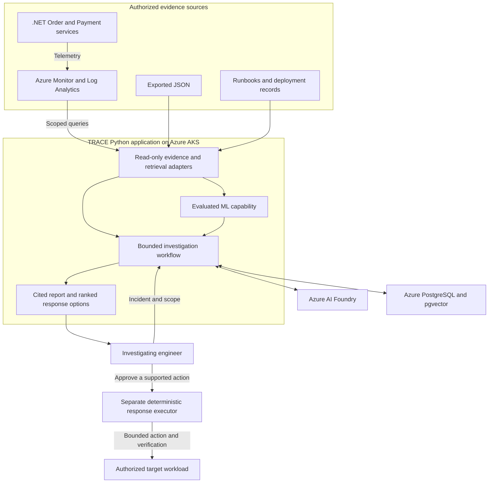

# TRACE

Telemetry & Root-Cause Analysis Copilot for Engineers — an Applied AI Engineering capstone focused on evidence-supported incident investigation and engineer-approved response.

TRACE combines authorized telemetry, operational knowledge, bounded tools and AI to help engineers understand incidents, compare response options and choose the next action.

## End-state architecture

The diagram below describes the planned final architecture. Components are delivered incrementally through the roadmap.



TRACE remains one modular Python application. Independently running .NET Order and Payment services provide the monitored testbed. Evidence integration starts with exported JSON and later adds scoped live Azure queries.

ML addresses a justified incident-analysis task, such as anomaly detection or signal prioritization. Candidate approaches include classical ML, deep learning, pretrained models and other suitable ML methods. The use case and method are selected through measured benefit against appropriate baselines, considering quality, reliability, latency, cost and operational complexity.

Source access, transmission to the model and report access have independent authorization checks. Hosted operation uses Entra Workload Identity, bounded execution, durable spending controls and auditable outcomes.

Terraform manages Azure infrastructure. GitHub Actions builds and validates container images, with reviewed releases promoted through Azure Container Registry.

## Investigation results and response selection

The completed application will produce:

- An observed incident timeline with traceable evidence.
- Supported hypotheses and competing explanations.
- Missing information, uncertainty and abstention where appropriate.
- Multiple response options with a clearly identified **recommended action**.

Response options include:

| Option | Purpose |
| --- | --- |
| **Rollback** | Restore a known-good release when evidence supports a regression and rollback prerequisites are satisfied. |
| **Corrective modification** | Propose a code or configuration change addressing the supported cause, with an explanation and regression-test plan. |
| **Temporary mitigation** | Propose an intervention that reduces impact while a lasting correction is prepared. |
| **Further investigation** | Identify targeted queries or checks needed to resolve uncertainty. |
| **Observe or escalate** | Recommend monitoring or specialist involvement when an actionable change is unsupported. |

TRACE will rank the available options and mark the recommended response. Each option will explain its supporting evidence, assumptions, expected benefit, risks, prerequisites, verification steps and recovery approach. Further investigation can be the recommended response when evidence is insufficient.

The engineer selects a response. Proposed code changes proceed through review, tests and the deployment pipeline. Supported operational actions require explicit approval of the concrete target and action, followed by deterministic execution and outcome verification.

## Project organization

- [TRACE Project](https://github.com/users/krispykrits/projects/2) — status and release grouping
- [Sprint milestones](https://github.com/krispykrits/TRACE/milestones) — all 18 planned increments
- [Backlog](https://github.com/krispykrits/TRACE/issues) — user stories and tasks

Individual issues are stories/tasks; milestones are sprints. Project Status is the authoritative work status. Future milestones remain undated pending capacity planning.

## Delivery roadmap

| Release | Provisional sprints | Outcome |
| --- | --- | --- |
| **Local MVP** | 1–6 | Synthetic Order → Payment incidents, a small retrieval corpus, bounded read-only tools, cited assessments, abstention, timelines and automated scoring |
| **Cloud MVP** | 7–9 | Containerized Azure AKS deployment, shared state, workload identity, observability, recovery, cost controls and teardown; independent .NET testbed with JSON-first evidence and later live Azure queries |
| **Full capstone** | 10–18 | Broader scenarios, evaluated ML suited to the selected use case, five-arm study, ranked response options, approved remediation, production hardening and final defense |

- [Complete project plan and release gates](https://github.com/krispykrits/TRACE/blob/main/docs/planning/capstone-project-plan.md)
- [Azure/AKS cloud direction](https://github.com/krispykrits/TRACE/blob/main/docs/adr/0015-azure-aks-cloud-deployment.md) and [cloud stories](https://github.com/krispykrits/TRACE/blob/main/docs/planning/azure-cloud-backlog.md)
- [.NET testbed and source-integration stories](https://github.com/krispykrits/TRACE/blob/main/docs/planning/dotnet-testbed-backlog.md)
- [Reliability, security and evaluation amendment](https://github.com/krispykrits/TRACE/blob/main/docs/planning/production-roadmap-amendment.md)
- [Implementation reuse review](https://github.com/krispykrits/TRACE/blob/main/docs/planning/production-usefulness-review.md)
- [MVP-first delivery tracker](https://github.com/krispykrits/TRACE/issues/9)
- [Charter and minimum decisions](https://github.com/krispykrits/TRACE/issues/1)

Customer and Notification begin as lightweight fixtures. The first investigator is evaluated before expanding ML or infrastructure. A justified, evaluated ML contribution and the full five-configuration comparison remain final capstone requirements.

Sprint numbers are provisional scope increments, not calendar commitments. Capacity, budgets, remaining technology choices and acceptance thresholds are recorded in the charter, plan and ADRs.

The repository currently contains planning records, a Python CLI, synthetic workflows and local investigation demonstrations. The roadmap and linked acceptance evidence track delivery of the target architecture.

## Local development

Use the [development guide](https://github.com/krispykrits/TRACE/blob/main/docs/development.md) for the Python 3.12/uv setup, safe local environment example, configuration precedence and structured logging conventions.

The [package layout and dependency rules](https://github.com/krispykrits/TRACE/blob/main/docs/architecture/package-layout.md) govern current and future code. Capability contracts and use cases remain independent of concrete adapters. Fast CI enforces import boundaries and tests the installed runtime wheel.

Key implementation references:

- [Synthetic Order–Payment workflow](https://github.com/krispykrits/TRACE/blob/main/docs/architecture/order-payment-workflow.md)
- [SQLite investigation store](https://github.com/krispykrits/TRACE/blob/main/docs/architecture/sqlite-investigation-store.md)
- [Authorized knowledge retrieval](https://github.com/krispykrits/TRACE/blob/main/docs/architecture/knowledge-retrieval.md)
- [Bounded context and retrieval evaluation](https://github.com/krispykrits/TRACE/blob/main/docs/architecture/retrieval-evaluation-context.md)
- [Architecture view](https://github.com/krispykrits/TRACE/blob/main/docs/architecture/README.md) and [ADR index](https://github.com/krispykrits/TRACE/blob/main/docs/adr/README.md)
- [Infrastructure responsibilities](https://github.com/krispykrits/TRACE/blob/main/deploy/README.md)
- [Operations](https://github.com/krispykrits/TRACE/blob/main/docs/operations/README.md) and [security boundaries](https://github.com/krispykrits/TRACE/blob/main/docs/security/README.md)
- [Sprint 1 evidence review](https://github.com/krispykrits/TRACE/blob/main/docs/sprints/sprint-01-review.md)

### Synthetic tool demonstration

```bash
uv run --locked python scripts/demo_tools.py
```

Demonstrates six synthetic tools and rejection of unauthorized, over-limit and shell requests. The [tool catalog](https://github.com/krispykrits/TRACE/blob/main/docs/architecture/investigation-tools.md) describes typed inputs, read-only source grants, time/result bounds, audit and current operational limits.

### Scripted evidence package

```bash
uv run --locked python scripts/demo_integration.py \
  --output /tmp/trace-s4-package.json

make integration-s4
```

Produces the scripted cited timeline/context package and verifies the assembled boundary with independent evaluator fixtures. See the [integration contract](https://github.com/krispykrits/TRACE/blob/main/docs/architecture/scripted-evidence-package.md) and [Sprint 4 review](https://github.com/krispykrits/TRACE/blob/main/docs/sprints/sprint-04-review.md).

### Offline investigation demonstration

```bash
uv run --locked python -m scripts.demo_investigator \
  --output /tmp/trace-investigator-demo.json
```

Use a fresh private output path. The demonstration covers answerable, insufficient-evidence and timeout cases using hand-authored model/review records.

The [bounded investigation use case](https://github.com/krispykrits/TRACE/blob/main/docs/architecture/bounded-investigator.md) connects scoped evidence, provider policy, finite execution and protected assessment publication. These offline demonstrations do not establish live diagnostic quality or grant operational execution authority.
