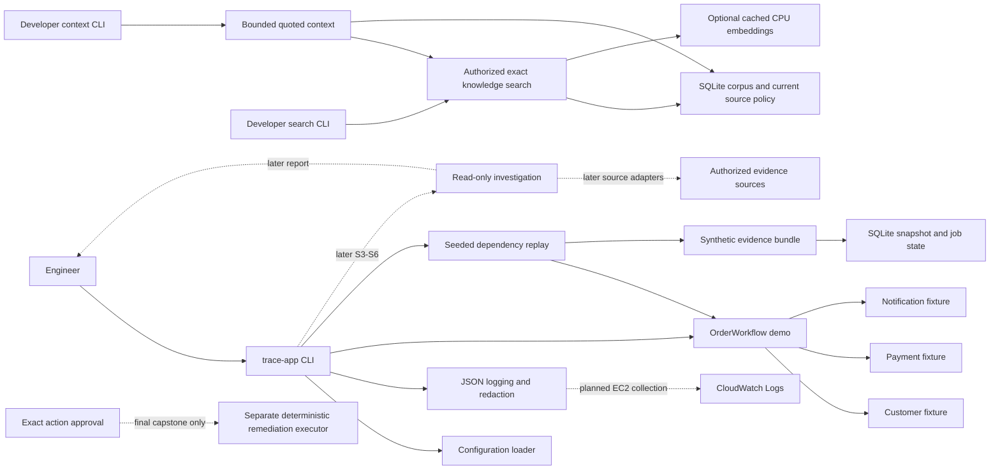

# TRACE architecture view

The [capability package layout](package-layout.md) and [ADR 0010](../adr/0010-capability-packages-and-adapter-boundaries.md) define dependency direction and composition; make architecture-check and make package-check enforce this during every future PR.

Status: Sprint 3 foundations including evaluation merged; Sprint 4 corpus and retrieval merged; bounded context proposed, 2026-10-12. This view describes implemented code and approved direction; it does not claim an incident investigation is implemented.

Solid arrows are implemented local behavior. Dotted arrows are planned boundaries or deployment work. [ADR 0001](../adr/0001-repository-runtime-and-local-tooling.md) selects one modular Python application; the current `src/trace_app` package contains CLI, configuration, structured logging and the synthetic Order workflow, dependency replay and SQLite snapshot/job-state adapter with in-process fixtures. [ADR 0002](../adr/0002-terraform-and-ec2-cloud-deployment.md) selects Terraform/EC2 for the Cloud MVP, and [ADR 0003](../adr/0003-cloudwatch-hosted-logging.md) selects hosted logging, but no EC2 runtime or hosted delivery is verified. No investigator, operational source adapter, generative model, HTTP API or remediation executor exists yet. The local [knowledge search](knowledge-retrieval.md) adapts Volume 4 lexical/semantic/hybrid baselines with a pinned optional cached embedding model. The SQLite adapter persists local synthetic snapshots and execution state; it is not a real-source integration. [ADR 0004](../adr/0004-synchronous-synthetic-order-workflow.md) records the synchronous demo boundary.

The Local/Cloud MVP investigation remains read-only. The final capstone's [approved production remediation scope](../planning/production-remediation-scope.md) requires a separate deterministic executor with proposal-bound approval, state revalidation, bounded execution and outcome verification. A source filter or investigation access cannot grant mutation authority.

- [Order–Payment workflow](order-payment-workflow.md) shows the implemented request path and fixture limits.
- [Evidence and data contracts](data-contracts.md) distinguish settings, logs, workflow records and incident evidence.
- [Dependency replay contract](dependency-replay-evidence.md) defines the version 1 envelope, replay rules and evaluator separation.
- [Development scenarios](development-scenarios.md) describe regression, degradation, missing/late telemetry, noncausal deployments and evaluator split/isolation rules.
- [SQLite investigation store](sqlite-investigation-store.md) defines persistence, retry/recovery, access and deletion rules.
- [Bounded evidence queries](bounded-evidence-queries.md) define local service/time filters, trusted scope and distinct incomplete/empty/failure results.
- [Incident timelines](incident-timelines.md) define UTC normalization, deterministic observation ordering, duplicate policy and scoped citation resolution.
- [Knowledge corpus](knowledge-corpus.md) defines source adapters, curated inputs, stable chunk provenance, atomic generations and current access/freshness/tombstone checks.
- [Knowledge retrieval](knowledge-retrieval.md) defines authorized lexical/semantic/hybrid search, citation checks, index rebuilds and measured development defaults.
- [Development evaluation](development-evaluation.md) defines candidate reports, offline fixture scoring, evaluator isolation, citation-support review and the baseline comparison protocol.
- [Interfaces and API contracts](interfaces.md) describe the current CLI and the deferred application/source APIs.
- [Development guide](../development.md) gives runnable local commands and the current quality gate.
- [Reuse review](../planning/production-usefulness-review.md) and [approved amendment](../planning/production-roadmap-amendment.md) explain why educational components must enter through TRACE-owned contracts.

The [passage evaluation and context contract](retrieval-evaluation-context.md) records #17's configured candidate limits, current source revalidation, exact byte budget and separate citation map. Evaluator-only labels/reviews remain outside runtime imports; human review gates acceptance.

The [read-only tool catalog](investigation-tools.md) describes #18 typed schemas, trusted authorization, externally enforced bounds, worker termination, partial/error outcomes and audit; [ADR 0011](../adr/0011-read-only-tool-execution.md) records the execution boundary.

The [scripted evidence package](scripted-evidence-package.md) composes scoped reads, observed timelines and revalidated knowledge references for the #19 Sprint 4 gate; [review and Sprint 5 handoff](../sprints/sprint-04-review.md) keep development, provider, operational and remediation acceptance separate.
