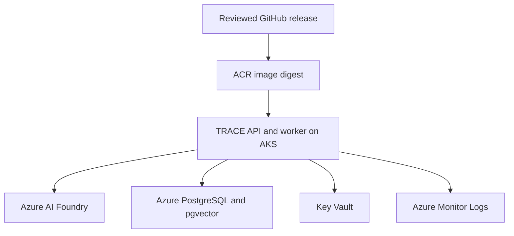

# Azure and AKS cloud architecture

Status: owner-selected cloud direction, 2026-10-14; implementation and hosted acceptance pending. [ADR 0015](../adr/0015-azure-aks-cloud-deployment.md) supersedes the AWS hosting direction. [The cloud backlog](../planning/azure-cloud-backlog.md) assigns design/implementation/acceptance work to S7-S9.

## Runtime and delivery boundaries

## End-state delivery update — 2026-10-15

[ADR 0021](../adr/0021-interactive-platform-and-repository-boundaries.md) selects an authenticated API and persistent investigation worker around the modular Python core. Retain CLI reproduction and keep evaluation in TRACE, excluded from runtime packages/images. Planned repositories: TRACE core/API/worker, trace-web, trace-testbed, trace-platform and trace-executor introduced with S14 remediation. Component CI/Dockerfiles stay with source; platform deployments pin compatible image digests. Repository extraction preserves historical reports/hashes and versioned contracts.

PostgreSQL-backed durable work dispatch is the initial choice: transactional submission, atomic claims, leases, cancellation, retries and shared attempt/spending admission. Reconcile uncertain external outcomes before retrying. No separate broker is required; add one only for demonstrated throughput/latency/contention/consumer needs. Use batch Jobs for evaluation, corpus rebuilds, migrations and scenarios.

Flexible capability contracts cover telemetry, knowledge, change/deployment records and workload state. JSON then Azure Monitor are first implementations. Preserve original identity/revision, timestamps, correlation, units, provenance and explicit completeness; enforce source/transmission/report rights independently, with scope/result/deadline/pagination limits. On-demand reads and batch import are initial modes; scheduled/event-driven ingestion and dedicated ingestion workers require a concrete lifecycle/volume/isolation need.

**Required web delivery:** after S8 API stabilization and before S15 pilot, provide submission, progress/cancellation, evidence/timeline and protected cited reports. S14 adds ranked-response comparison, selection and concrete approval UI/API, plus separate deterministic execution with distinct credentials. This is required scope. S7 must size stories and place them within S8-S14 capacity or add an undated increment before S15; do not assume it fits the existing 18 increments unchanged.

These are planned cloud relationships, not provisioned resources or acceptance evidence. The existing native Foundry connector and synthetic live check are separate Local MVP evidence. Terraform manages the Azure resource lifecycle; the application release pipeline promotes an immutable digest/configuration after review.

## Identity

AKS OIDC/Entra Workload Identity binds the specific application service account to an identity with the minimum permissions on Foundry and approved secrets. The cluster/node identity handles platform needs such as registry pulls; it does not grant investigation tools cluster administration. CI/Terraform identity, database migrations/admin, runtime database access, collector writes and telemetry reads remain separate grants.

Current local API-key fallback and user portal roles are not proof that a pod can obtain and use an Entra token. #58 owns credential/token configuration and actual cloud inference acceptance, including missing/revoked/wrong namespace or service-account cases. Account restrictions must be respected. Secrets do not enter image layers, manifests, prompts, logs or evaluation artifacts.

## Shared state and execution

Azure Database for PostgreSQL Flexible Server is the managed database baseline; pgvector must be supported, allowlisted and enabled on the target database. Preserve SQLite locally and implement PostgreSQL behind TRACE-owned adapters. #57 migrates evidence IDs/times/revisions, jobs/attempts, corpus/content/policy generations, review/response protection and usage/reservation states.

The private Local MVP SQLite journal serializes local process admission; a copy in every pod cannot enforce a shared model budget. PostgreSQL admission/leases must prevent concurrent overspending, duplicate claims and stale-attempt reuse. Reconcile unknown in-flight outcomes conservatively before retries. The $20/month application model cap survives pod/job deletion and remains separate from account-wide billing and infrastructure cost.

Do not store durable state only in an ephemeral container filesystem or scale paid workloads before shared admission is tested. Mount/use only approved persistent/cache paths, bound resources and temporary files, and make cancellation/termination/Job retries obey the application execution policy. Use API readiness and worker liveness/startup/drain checks. S7 specifies durable claims, leases, cancellation and uncertain-outcome recovery.

## Telemetry and source access

Keep current correlated JSON stdout/stderr and pre-transmission redaction. Platform-managed collection supplies Azure Monitor/Log Analytics after #59 verifies correlation, redaction, permitted readers, retention and collector recovery. Do not enable raw prompt/response capture. TRACE's own telemetry is not an operational incident source; real logs/metrics/deployments require their independent source contracts and data-owner grants.

Provider-data-policy.v1, current source/transmission permissions, quoted untrusted context, stable citations, protected assessment/review/export rights and evaluator isolation apply in every pod and later tool/model step. No source permission or operational mutation follows from cloud deployment.

## Design and acceptance gates

#55 records subscription/tenant, resource ownership, region/model processing location, AKS mode/tier/version/node pools, network exposure/egress, ACR/database shape, Entra grants, Key Vault, Blob state/locking, workload, costs and retention. No values or provisioning are inferred from this architecture.

#56 produces reviewed image/provenance/scan evidence and authorized ACR publication. #57 supplies shared storage/migration/recovery. #58 runs the accepted workflow and proves workload identity, immutable promotion/rollback and lifecycle bounds. #59 verifies hosted telemetry. #60 proves fault/security/concurrency/cost, restore and teardown/recreation with named blockers and residual-resource accounting.

The owner-approved $20/month model limit is not a cluster budget. AKS Free still incurs consumed-resource charges; production tier/availability claims require a separate decision. Define backup/log/state retention, approved deletion and remaining billable resources before teardown. No successful synthetic test alone establishes Operational Pilot usefulness or final production-remediation acceptance.
