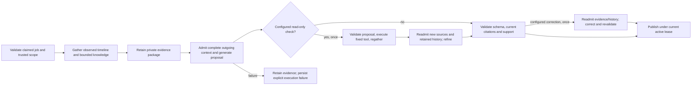

# Bounded evidence-first investigator

Scoped story [#37](https://github.com/krispykrits/TRACE/issues/37), following accepted #36 / merged PR #53. [ADR 0016](../adr/0016-bounded-investigation-and-private-publication.md) records the proposed workflow/publication decision.

## Application contract and composition

`bootstrap.create_investigation_workflow` selects the private SQLite workflow adapter. Its caller supplies an existing claimed investigation/attempt, `ProviderScope`, trusted tool scope, one `ExecutionSession`, `PolicyModelProvider` or an explicitly missing model, an independent current `EvidenceAuthority`, and `SupportReviewReader`. Model/tool scope and session identity must match. The constructor does not authenticate callers, derive transmission permission from repository access, select a fallback or provision anything.

The job's subject service must belong to the trusted evidence service grant, and its environment must match. Its validated stored window bounds all gathering and proposed evidence checks. Gathering reads the authorized dependency services in that window, not a model-provided access list. Knowledge retrieval uses the independent corpus scope. Existing #10 submit/idempotency/claim/lease/cancellation contracts remain the job foundation; claim ownership is required before constructing execution. There is no automatic lease renewal or paid replay.

`WorkflowOptions` contains explicit booleans: `next_check`, `correction`, `evidence_only`, all false by default. A check/refinement runs at most once; a correction runs at most once and requires a configured correction allowance. No retry loop exists. If the required model is missing, generation fails while retaining the gathered package. Evidence-only mode is deliberately selected and produces no assessment.

`source_content(package)` defines the exact scalar JSON projection an independent authority must resolve as a reviewed `content` field: operational kind/record/payload or a knowledge passage/citation mapping. This is a projection contract, not an authorization adapter. The authority must resolve current originals, source access, separate transmission/source-owner permission, reviewed fields/identifiers and expiry; a package/tool result cannot provide its own grants. Actual operational source/authentication adapters remain open gates. The demonstration's source authority explicitly grants fictional fixtures and re-reads private SQLite/corpus policy; it is not a production default.

## Fixed transitions and limits



Model/source text cannot change these transitions, configuration, budgets or source grants. `assessment.v2.next_check` is a proposal parsed by the fixed #18 catalog; SQL/shell/writes/evaluator storage have no entry. Evidence windows cannot leave the investigation window. Every later call, including refinement/correction, uses the complete provider gate with current source/transmission permission, redaction/provenance, signed admission, content-free audit and protected history. New tool results cannot borrow transmission permission from a successful read.

The demonstration profile uses the existing finite #36 policy: 120-second investigation deadline, three model calls, 100 tool calls, zero retries, one correction allowance, 20,000 input allowance / 2,048 native output tokens per call, 70,000 aggregate tokens, 30-second model / five-second tool bounds and 65,536 response/result bytes. These are implementation controls, not owner performance thresholds. Production callers choose a validated explicit policy and the existing versioned Azure price/monthly journal, capped at the approved $20 with known prior spend. Missing usage stays unknown; reservations/estimates are not settled or account-wide billing.

The full observed timeline precedes interpretation. Model context selects two latest logs, one latest metric, one latest deployment and two passages. Other evidence/passages remain in the local bundle; `model_context_omissions` and source-gap IDs disclose exclusions. Selection is not a causal heuristic. Retained admitted history is excluded from omission lists. A closed `InvestigationFrame` supplies only safe service/environment/window, exact admitted event order, source gaps and fixed phase/validation-reason metadata. It cannot authorize a call.

After an optional check, the workflow regathers through the same tool session. Observed timeline changes reject refinement; knowledge mappings are merged without silently replacing old quoted sources. Up to ten whole passages / 16,384 context bytes are retained locally, with existing authorization/provenance checks. Only bounded selected content and protected history pass to the provider; every contributing dependency remains covered by #34.

## Outcome and persistence matrix

| Trigger | Execution / assessment | Persisted/released result |
| --- | --- | --- |
| All #35 checks plus current trusted support pass | completed / supported or abstained | Accepted structured report, citations, provenance and observed timeline |
| Schema/current citations pass; support unreviewed, indeterminate or disputed | completed / pending | `review_required`, explicitly untrusted support-review packet |
| Explicit evidence-only mode | completed / pending | Observed package; assessment not performed |
| Model absent, timeout/quota/dependency failure, malformed/unsupported report, exhausted bounds | failed / pending | Explicit model/validation failure alongside retained evidence; no accepted diagnosis |
| Cancellation or expiry | cancelled/expired / pending | No accepted publication; already retained evidence stays private |
| Duplicate/stale attempt | no new publication or model replay | Existing durable result is preserved; invocation rejected |
| Gathering fails | failed / pending | Tool/failure audit; no fabricated observed bundle |

Schema 3 adds `workflow_runs` and `workflow_artifacts`, with investigation/attempt foreign keys. Writable startup upgrades schemas 1/2 transactionally and preserves snapshots and execution reservations. If a legacy budget record lacks a port's previous outcome despite recording calls to that port, another dispatch fails closed; migration cannot invent initial/retry/correction permission. Read-only workers require schema 3. One workflow row per investigation prevents a restart from starting another paid workflow implicitly. A workflow-issued publication commits its necessary structured content and job/attempt outcome atomically after checking current scope/attempt/lease/expiry. A cloned/unissued record, cancelled job or stale lease cannot publish. Terminal deletion cascades these artifacts; the independent spending journal remains intact.

Raw gathered content is private and conservatively `unknown` sensitivity. Validated report/proposal storage inherits original input sensitivity before redaction. Logs and metadata retain correlation/attempt/artifact/version references, selected policy/provider/prompt/tool configuration, usage/cost and fixed outcomes; no raw source, prompt, response, removed value or untrusted exception text enters telemetry. Persisted malformed model output is excluded. `SQLiteWorkflowStore.metadata` checks access scope and exposes content-free descriptors only; it provides no report/body getter.

`WorkflowResult.read(original_provider_scope)` is local protected delivery. It rechecks exact current source projections/access/expiry, protected model dependencies and current human-support bindings, with another source check after review. This uses the independently composed authority, not another investigator tool/model dispatch after terminal state. Changed source content/revision, denied actor, revocation or withdrawn support blocks content. Already authorized dictionaries cannot be erased retroactively. There is no export API here; #38 must implement authenticated restoration/inspection/review persistence/export without treating stored accepted status as standing source/review permission.

## Reproducible offline demonstration

```sh
uv run --locked python -m scripts.demo_investigator --output /tmp/trace-investigator-demo.json
uv run --locked python -m unittest tests.contracts.test_workflow tests.integration.test_workflow -v
make check lint format-check type-check architecture-check test integration package-check
```

Choose a fresh output path; the demonstration writes a mode-0600 JSON file without overwriting it. It runs the answerable `c01`, insufficient `c04` and explicit provider-timeout paths through the actual application use case, real SQLite/corpus/read-only workers and a hand-authored model. Synthetic support-port records exercise acceptance; they are not real human endorsement or quality scoring. Each run declares `offline_hand_authored_simulation`, zero actual provider calls and no actual human review. The timeout retains its evidence bundle and has no assessment. Fakes remain in scripts/tests, outside the runtime wheel; no hidden evaluator labels are loaded. Frozen reports and version-1 scoring remain unchanged.

The workflow demonstration passed with accepted supported and abstained simulation reports and a failed timeout retaining evidence. All required local gates passed with 312 tests (44 unit, 93 contract, 175 integration), architecture checks and installed-wheel verification. No new Azure assessment-prompt/live workflow check was run; #34's earlier native connector-health check remains separate. Actual model quality, authenticated operational source/reviewer access, retention, the S6 release and operational/cloud/remediation gates remain separate.
