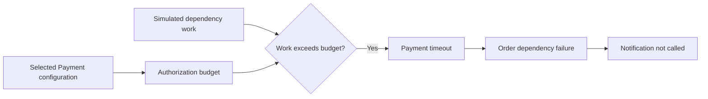

# MVP development scenarios

Issue [#12](https://github.com/krispykrits/TRACE/issues/12) extends the [dependency replay](dependency-replay-evidence.md) with a small synthetic suite. The generator revision is `mvp-suite.v1`; operational evidence and typed snapshots retain their existing schema version `1`. No new dependency, deployed service or model is required.

## Replay and reset

```sh
uv run --locked trace-app replay-scenario --environment test --case c01 --seed 17
uv run --locked trace-app replay-scenario --environment test --case c02 --seed 17
uv run --locked trace-app replay-scenario --environment test --case c03 --seed 17
uv run --locked trace-app replay-scenario --environment test --case c04 --seed 17
uv run --locked trace-app replay-scenario --environment test --case c02 --seed 17 --without-distractor
```

Each command prints a JSON `status` and `evidence` object. `evidence` contains `schema_version`, an inclusive UTC `query_window`, `sources` and typed `entries` (`kind`, `record`, `payload`). Correlated runtime logs go to stderr. Invalid seeds/cases or a production environment fail with exit code 2 before workflow execution; successful fixture export returns 0 even when the observed Order request fails. Source gaps are evidence availability, not replay execution failure or an automatically generated assessment.

`ScenarioSession(ScenarioConfig(case_id, seed)).replay(collected_at=utc_datetime)` provides an `EvidenceSnapshot` compatible with the SQLite store and bounded query service. One replay requires `reset()` before another; reset clears recorded events and notification count. Supported seeds are integers 0–1,000,000,000, excluding booleans. Version and environment are validated. Each CLI invocation creates a fresh session.

Version, case, seed, environment and event ordinal determine stable hashed identities. Neutral case IDs, filenames and a common source revision avoid readable answer labels; opaque identifiers still must not be used as learned answers. Collection time and the optional Notification deployment do not change the other records' IDs, event times, payloads or integrity hashes. The integrity digest includes the typed payload; it detects accidental fixture changes and does not establish source authenticity. Logical event times use January 1, 2026 UTC plus the seed offset and one second per event, as in the original replay. These timings do not measure request latency.

## Evaluator catalog and mechanisms

This catalog and the [manifest](../../evaluation/ground_truth/mvp_suite_v1.json) are evaluator/developer material. Do not include them in investigator prompts, tools or retrieval corpora.

| Case | Controlled mechanism | Investigator-visible distinction | Expected assessment |
| --- | --- | --- | --- |
| c01 | Payment v2 reduces a 50 ms authorization budget to 5 ms; unchanged 10 ms dependency work now exceeds it | Previous/current budget samples, work sample, Payment timeout and deployment | Supported budget-regression hypothesis with the recorded evidence; time order alone is insufficient |
| c02 | Payment v2 retains its 50 ms budget; dependency work is 100 ms | Unchanged budget, work sample and the same timeout symptom; nearby Payment deployment is noncausal | Supported downstream-degradation hypothesis |
| c03 | Same execution mechanism as c01; Payment capture is unavailable | Order failure, Customer lookup and unrelated Notification deployment | Abstain on a specific mechanism and request missing Payment evidence |
| c04 | Same execution mechanism as c02; Payment capture is unavailable | Same observation/service/time/payload sequence as c03 | Same abstention requirement despite different hidden cause |

The replay runs the existing `OrderWorkflow` with an injected deterministic Payment adapter. A simulated work value greater than the selected active budget raises `DependencyUnavailable("payment")` before authorization. Order propagates that failure and does not call Notification. The deployed configuration controls the budget used by the adapter; the deployment record itself does not create a failure. The predeployment sample is 50 ms in both complete cases. Counterfactual tests restore a sufficient budget or reduce work and verify that authorization succeeds, including equality at the budget boundary. Values are synthetic fixture settings, not release thresholds or measured production timings.



A successful Notification v2 deployment is placed at the Order-request timestamp in every default case. It changes no fixture adapter or configuration and lies outside the failed execution path. `--without-distractor` removes only that record and changes its source availability to `capture_disabled`; the causal result and all other records remain identical. In c02 the successful Payment deployment also leaves the active budget unchanged. These cases prevent treating a nearby deployment as cause solely by timestamp.

## Missing and late capture

c03/c04 omit all Payment logs, metrics and deployments and report each source as `unavailable` with reason `capture_gap`. Missing records are never reconstructed from the known generator mechanism. The visible pairs match after ignoring opaque source/evidence/correlation IDs; IDs do not encode readable family names. Manifest supporting ordinals for these cases support the observed failure, not an answer to the hidden mechanism.

Complete cases simulate metric collection 30 seconds after log/deployment collection. The supplied `collected_at` is the final simulated capture time: metric records use it, while logs/deployments use it minus 30 seconds. No process sleeps, and a default capture ends at the current UTC time. Changing that anchor changes collection times only. A metric can describe an earlier observed event while arriving later; timeline ordering must use `observed_at` and retain collection times separately. Delayed capture does not imply missing records in this completed export.

Every bundle also records `sanitized_export: unavailable` with reason `no_authorized_export_supplied`. Synthetic generation is not operational-source acceptance.

## Manifest, isolation and contamination policy

Each evaluator manifest entry records seed/environment, active and previous budgets, work/capture configuration, causal mechanism/chain, expected observed events, supporting and missing record ordinals, distractors, competing explanations and abstention conditions. Ordinals resolve to the last component of the generated evidence ID for the same configuration, for example `ev-<opaque-run-digest>-004`. The manifest and recorded seed/configuration identify the exact supporting records without putting evaluator labels in the runtime package.

The runtime never reads the manifest. Its allowlisted export excludes case/configuration, expected assessments, split groups and causes. CLI flags are synthetic fixture selectors for a developer, not investigator input. Give the investigator only the exported evidence and a neutral service/window brief. Runtime stderr logs, this catalog, generator code, command history and evaluator files are outside that input. SQLite roundtrip/query tests retain the same payload/provenance and reject evaluator-field injection. As in ADR 0007, a developer checkout can physically read evaluator files; a permission-separated evaluation process is required before deploying held-out cohorts.

All four cases, all seed variants and the earlier `payment-dependency.v1` fixture belong to one related `order-payment-timeout-v1` development group. Do not allocate near-duplicates from this group to validation or final test. Validation/final-test groups and answers are reserved and have not been generated or accessed by this story. Later refinement must select independently grouped templates, including separate known-family/unseen-variant and unseen-family cohorts, before the final study; these four cases cannot supply both training and independent test evidence. See [evaluation policy](../../evaluation/README.md).

An operational historical-replay cohort must be separately permissioned by a named source/data-access owner, versioned and sanitized, and kept outside the held-out capstone cohorts. No such owner/export is available, so the manifest marks this cohort blocked. Synthetic success does not establish real operational usefulness.

## Verification and next scope

`make test` covers all cases' reset/seed identity, cause counterfactuals, distractor removal, matched missing observations, delayed capture, manifest/record resolution, SQLite restart/query compatibility, schema rejection and export isolation. `make integration` runs each case through a real CLI process in a temporary working directory without evaluator files and checks rejected production/invalid requests. `make check lint format-check type-check test integration` is the complete local gate.

Issue #13 owns the full timeline contract and authorized citation behavior; #14 owns scorer schemas and failure-aware scoring. This story supplies fixtures and expected outcomes, without claiming either capability complete, a Local MVP release accepted, or final benchmark results.
