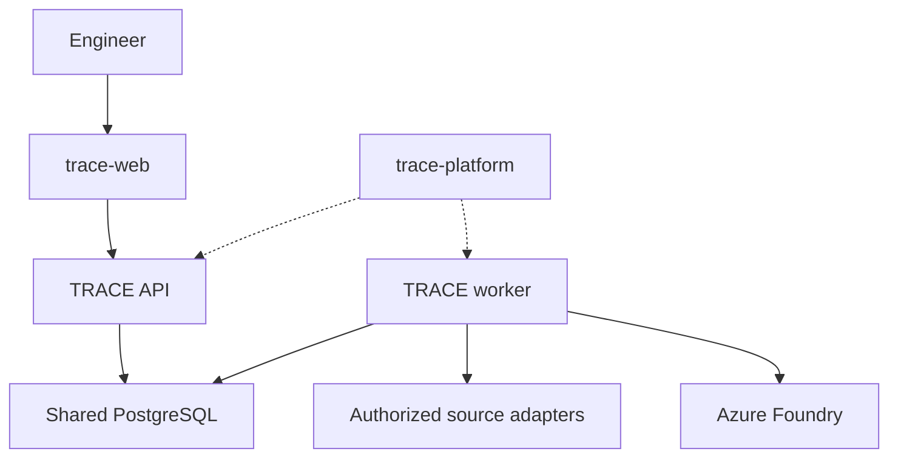

# Sprint 7 platform design and implementation handoff

Status: **proposed for owner review; not implemented or approved for provisioning.** Scope: [#55](https://github.com/krispykrits/TRACE/issues/55), coordinated with [#89](https://github.com/krispykrits/TRACE/issues/89). Baseline: `main` at `5c51f61d1ba2f35c84dcf9fc7d79946c9db0499c`. [ADR 0021](../adr/0021-interactive-platform-and-repository-boundaries.md) records the accepted direction; this document refines it without claiming a running API, worker, PostgreSQL adapter or AKS deployment. [Inventory and migration](../planning/s7-repository-and-evidence-inventory.md) owns file destinations and the staged backlog.

## Current system and objective

The checkout has a modular Python CLI, bounded investigation workflow, authorized evidence/retrieval tools, Azure model adapter and local SQLite stores. The CLI's `LocalInvestigator` submits and runs a job in-process; its filesystem profile, source grants and provider journal assume trusted local callers. Investigation and attempt records, execution calls, workflow artifacts, corpus generations and provider reservations already have separate persisted identities. These mechanisms inform hosted contracts but do not establish authenticated users or shared cloud admission. The existing hosted diagram is a target, not a deployment.

The destination is an interactive read-only investigation platform with an API and independently running worker. The first monitored workload is the separate .NET Order/Payment testbed; JSON export/import precedes live Azure source queries. Recommendations remain distinct from approval or action. Preserve the CLI and local SQLite for local workflows. Real diagnostic quality and the incomplete owner handoff retain their existing gates.

The platform repository controls infrastructure and release configuration; it does not grant investigation or source access. The testbed is an independent source, and the later executor is a separate trust boundary, not a worker tool.

## Repository and release boundaries

| Destination | Owns | Excludes / dependency |
| --- | --- | --- |
| TRACE | Python domain and capability contracts, API/worker/CLI entry points, adapters, component CI and image build, small test fixtures, independent evaluation tooling | Held-out answers and evaluation outputs from runtime images; no dependency on web or platform source |
| trace-web | Web source, tests, component CI/image and user-facing interaction | Source, database or model credentials; uses a versioned TRACE API contract |
| trace-testbed | .NET Order/Payment workloads, bounded scenarios, telemetry/export contract, component CI/images | TRACE runtime dependencies and authority to authorize TRACE source/model access |
| trace-platform | Terraform, environment configuration, cluster/network/identity/monitoring and release composition | Application implementation and unpinned mutable release tags; deploys reviewed image digests |
| trace-executor | Versioned supported action adapters, durable action idempotency/reconciliation and health verification, introduced in S14 | General model-selected shell access or use of investigator read credentials for mutation |

These are planned destinations, not assertions that repositories exist. Keep component Dockerfiles and CI with the source they build. Define API/schema versions and compatibility checks before independent publication. A release record must name source commit, locked dependencies, image digest, configuration/schema versions, migration and rollback prerequisites; the platform pins that record's compatible artifacts. Do not remove the old consumer or rewrite history until replacement links, hashes, tests and historical reproduction are verified.

## API and worker contract

These are proposed semantics, not implemented endpoint names or an assertion of an approved identity provider.

| Operation | Required behavior |
| --- | --- |
| Submit | Authenticate principal; derive allowed scope from trusted server-side authority. Validate service, environment, UTC window and limits. Atomically store request and enqueue it. Scope the idempotency key to principal/tenant and canonical request; the same key and body returns the original ID, a changed body conflicts. A client-supplied principal or scope never grants access. |
| Status | Reauthorize each read and return job and attempt state, timestamps, bounded error codes, and separate assessment/review status. Do not return protected report text by default. |
| Cancel | Reauthorize and persist cancellation atomically; queued jobs must not start, and running workers must observe it before every further tool/model call. A dispatched external call may still finish; keep its accounting and outcome. Repeated cancellation is idempotent. |
| Report and evidence | Reauthorize against current access, source/revision, sensitivity and support-review bindings before each read/export. Preserve incomplete/denied/unavailable outcomes. Never treat an absent store as empty success or a pending review as acceptance. |

Use opaque server-generated investigation/attempt IDs and correlation IDs; record contract version and request digest without raw prompts, secrets or evaluator answers in logs. HTTP status codes, pagination and response schemas must be frozen in #58 before implementation; do not infer them from this design. Authorization failure should not disclose another scope's job existence. The UI holds no source or database credentials.

**Job lifecycle:** `queued → running → completed | failed | cancelled | expired`; assessment and review remain separate states. A cancellation request can precede final cancellation while an in-flight provider request is reconciled. A worker claims one authorized job in a short transaction using database time, a fresh attempt identity and lease; renew only while it remains owner, not cancelled and within the original deadline. Publication and final state changes require the active lease/fencing identity in the same transaction. An expired lease does not reset execution quotas or authorize another paid dispatch. Database outages fail closed.

**Provider call lifecycle:** atomically reserve the monthly allowance and applicable run/investigation limits in the shared ledger, persist attempt/call identity, then recheck current source/transmission rights and lease before dispatch. Record whether dispatch was reached and actual usage when known. Keep a conservative reservation for a timeout, termination or unknown dispatch/usage until a separately designed reconciliation confirms the result; do not automatically replay it. An accepted provider request cannot be made exactly once solely by a database transaction. Provider-side idempotency, if available, must be evaluated explicitly; absent proof, unknown means stop. The $20/month TRACE model reservation cap is not an Azure account-wide billing cap and excludes infrastructure.

## Data and source contracts

| Data / capability | Design requirement |
| --- | --- |
| Shared investigation state | Jobs, scoped idempotency keys, attempts, lease/fencing, cancellation, deadlines, snapshots, source revisions and workflow artifacts survive pod replacement. Migration preserves stable IDs and original timestamps. |
| Execution and model ledgers | Shared atomic calls, token/tool/deadline quotas and monetary reservations across workers and restarts; a pod-local SQLite copy cannot enforce a shared cap. Distinct investigation and provider accounting must be consistent at their dispatch boundary. |
| Knowledge and review | Preserve corpus document/generation and citation identity, protected report bindings, source/current-rights checks, support decisions and audit provenance. Pin compatible index/model/version; test restore and rebuild. |
| Source adapters | Declare capabilities and allowed filters for telemetry, knowledge, changes and workload state. Enforce access, scope, window, pagination, result/byte/deadline bounds. Normalize original IDs/revisions, event/collection time, correlation and units. Preserve success-empty, partial, unavailable and denied as distinct outcomes. |
| Data boundaries | Source access, model transmission and saved disclosure are independent authorizations; no grant is inferred from source text. Keep evaluator labels and held-out answers outside runtime and retrieval. Do not send raw provider output, credentials or sensitive fields to operational logs. |

Start with supported JSON imports and scoped Azure Monitor reads as separate adapters. On-demand reads and batch import are the initial patterns; add scheduled/event-driven collection or an ingestion worker only for a demonstrated lifecycle, volume or credential-isolation need. A model cannot issue arbitrary provider queries or choose its own grants.

## Identity and Azure design

| Principal | Intended minimum responsibility | Explicit separation |
| --- | --- | --- |
| Human / web client | Authenticated API use within authorized scope | No direct database, model, source or platform secrets |
| API service account | Authenticate and authorize requests; limited database operations for submission/status/cancellation | No implicit source querying or operational mutations |
| Investigation worker service account | Claim authorized jobs, call approved read adapters and Foundry, write scoped results and reservations | No Terraform/cluster administration or remediation write authority |
| Platform deployment identity | Reviewed Terraform and release changes | Not the running worker's model/source identity |
| Cluster/node pull identity | Cluster and registry-pull functions | Does not grant application inference or database access |
| Collector and telemetry reader | Write permitted TRACE telemetry / read approved logs | Separate from investigation data-source permissions |
| Later executor | Approved versioned actions and verification on exact targets | Separate credentials and durable action authorization; not inherited from a recommendation |

The target uses AKS OIDC and Entra Workload Identity bound to specific Kubernetes service accounts, with scoped Foundry/Key Vault and approved source roles. Federation subject, issuer, namespace, audience, token path, credential rotation and revoked/wrong-account cases require implementation verification. Database authentication method, private connectivity, egress policy, ingress/auth provider, tenant boundaries, Key Vault access and exact roles remain open design inputs. No local API key, user portal role or node identity proves pod authorization.

Terraform design must pin compatible provider versions, use an access-controlled Azure Blob backend with locking, separate state/deployment access, produce a reviewable plan and promote approved image digests. Validate account restrictions, quotas, Foundry processing location and regional resource availability in the actual subscription. Kubernetes and PostgreSQL/pgvector versions, cluster mode/tier, node pools, registry/database shapes, detailed recovery objectives and resource-specific retention are **unselected**. Trace-platform's configuration, state and plan may contain sensitive metadata and need restricted access.

## Owner inputs

The owner supplied these planning inputs on 2026-10-30. They do not authorize provisioning, paid calls or a resource configuration. Subscription IDs and Azure resource links are not recorded in this public document.

| Input | Owner direction / status |
| --- | --- |
| Subscription | Azure for Students. Available credit, remaining balance, quotas, restrictions and eligible services must be verified in the account; no credit amount is assumed. |
| Preferred Azure region | North Central US. The actual existing Foundry resource and model-processing location must be verified separately; a resource name does not prove deployment or processing location. |
| Operating schedule | Run during development, experiments and demonstrations rather than continuously. Exact hours, shutdown and restart approach are not yet selected. Stopped workloads may still incur storage, network, database or other charges. |
| Availability | Occasional downtime is acceptable; high availability is not required. Recovery time and acceptable data loss have not been set. |
| Resource administrator and operator | The project owner will administer Azure resources and act as operator. Exact identities and access grants still need verification. |
| Retention | Approximately 14 days is a tentative direction. The owner has not selected separate periods for application logs, testbed recordings, evaluation evidence and backups; verify service minimums and exceptions before configuring deletion. |
| Infrastructure budget | The owner accepted a **$15/month planning target**, separate from the existing $20/month TRACE model allowance. Together these amount to $35/month at the full model allowance, excluding any other account usage; this is not a verified estimate, account-wide hard cap or authorization to provision. Price the proposed configuration before applying it. |
| Cost monitoring | Plan infrastructure budget alerts at 50%, 80% and 100% ($7.50, $12 and $15) and verify alert delivery and available subscription scopes. Azure budget notifications do not themselves stop resources or guarantee a spending cap. No alert or automation has been configured. |
| Project knowledge space | The owner selected their OneDrive for now, with adviser access to detailed planning, research and academic/defense notes. The account type, sharing setup and continued access must be confirmed; see the [inventory](../planning/s7-repository-and-evidence-inventory.md). |
| Artifact storage | The owner accepts private Azure Blob as the planned S8 destination for suitable large datasets and retained evaluation artifacts. Exact access, resource configuration and retention remain open; acceptance of the destination does not authorize provisioning. |

## Cost model and missing inputs

No credible total can be computed yet: the owner has identified Azure for Students, a preferred North Central US region and a $15/month infrastructure planning target, but actual offer/credit, runtime hours, node and database sizes, log volume, network pattern and detailed retention/recovery settings remain unknown. Do not call a placeholder a measured estimate. Prepare a dated Azure Pricing Calculator estimate once these inputs are supplied; document currency, taxes, assumptions, calculator output and whether it fits the owner-approved planning target. An illustrative bill of resources is:

| Cost item | Quantity / driver to measure | Recurring or residual consideration |
| --- | --- | --- |
| AKS control plane and nodes | Chosen tier, node SKU/count, hours, disks and availability | Nodes/disks and selected tier have distinct billing drivers; capacity must fit actual workload |
| PostgreSQL and pgvector | Compute tier/size/hours, storage, HA and backup retention | Storage/backups can remain chargeable after compute changes; restore may create a second server |
| ACR | Tier, stored image GB, transfers and retention | Retained images remain after a workload is stopped |
| Monitor / Log Analytics | Ingested GB, query volume and retention by table | Existing data/retention may remain after workloads stop |
| Key Vault, storage and network | Operations, state/artifact/backup GB, ingress/egress and approved private connectivity | State, artifacts, public IPs and network endpoints may persist after teardown |
| Foundry inference | Actual usage/model/deployment and application reservations | Separately track the existing $20/month TRACE model cap; other Azure callers and infrastructure are outside it |

Use the [Azure pricing calculator](https://azure.microsoft.com/en-us/pricing/calculator/), [AKS pricing-tier documentation](https://learn.microsoft.com/en-us/azure/aks/free-standard-pricing-tiers), [PostgreSQL compute guidance](https://learn.microsoft.com/en-us/azure/postgresql/compute-storage/concepts-compute), [Container Registry pricing](https://azure.microsoft.com/en-us/pricing/details/container-registry/), [Azure Monitor cost guidance](https://learn.microsoft.com/en-us/azure/azure-monitor/cost-usage) and [Azure budget alerts](https://learn.microsoft.com/en-us/azure/cost-management-billing/costs/tutorial-acm-create-budgets) for current terms. The AKS free tier does not remove underlying resource costs. Stopped PostgreSQL Flexible Server instances automatically restart after seven days; verify storage and other residual charges and incorporate this behavior in an approved operating plan. These links do not select a SKU or authorize configuration.

## Migration, release and failure verification

1. Baseline local schema versions, identities, corpus generations, protected artifacts, current source/review grants and the latest complete provider journal. Freeze a consistent, private SQLite backup set and record hashes; preserve original evidence.
2. Implement separate PostgreSQL adapters under #57. Test a migration in an isolated environment without paid dispatch; reconcile foreign keys, record counts, stable IDs/revisions, access bindings and a current complete monetary ledger. Verify pgvector availability and reproducible index rebuild against the selected versions.
3. Test simultaneous claims/reservations, lease expiry/fencing, worker death before/after dispatch, unknown usage, cancellation, database outage, revoked source rights and atomic publication. An older backup cannot silently replace a newer spending ledger. Disable live dispatch until ledger freshness and all writers are reconciled.
4. Build and verify the same locked, non-root image for API/worker with distinct entry points and identities under #56/#58. Exclude secrets/evaluator inputs; record SBOM/scan/provenance and promote an immutable digest. Roll back only to a version compatible with the current schema or use a tested restore; do not roll back spending state to make calls available.
5. Demonstrate backup/restore, secret rotation, log redaction/reader access, retention, release rollback and billable-resource teardown in the authorized environment under #59/#60. Record residual storage, state, backups, logs and network resources. Test cases and actual results are separate evidence.

## Sequencing and acceptance

Per the owner's current direction, review this redesign before resuming #87's live runner; #65 remains the separate actual-output quality review. The draft #94 and additional workspace-only work are incomplete inputs, not merged runtime or diagnostic evidence. Reassess their journal/prompt and approval boundaries after this design; do not discard unmerged work or silently treat it as hosted shared admission. Hosted implementation acceptance still requires the diagnostic decision and reviewed design; no paid call or Terraform apply is implied by reviewing this document.

[#55](https://github.com/krispykrits/TRACE/issues/55) is ready for owner design review only after its repository/source/identity/dispatch design, inventory, verification and open gates are linked. Final acceptance also requires the actual owner-reviewed design, verification of account/region and detailed retention, and a defensible bill of resources compared with the agreed planning target. [#56](https://github.com/krispykrits/TRACE/issues/56)–[#60](https://github.com/krispykrits/TRACE/issues/60) own subsequent implementation and evidence. Do not mark #55 complete from a draft document.
